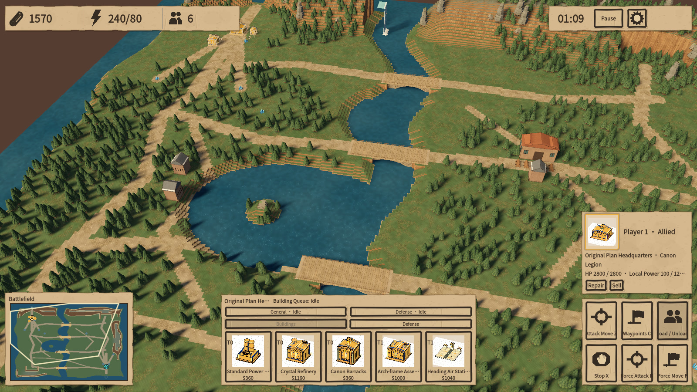
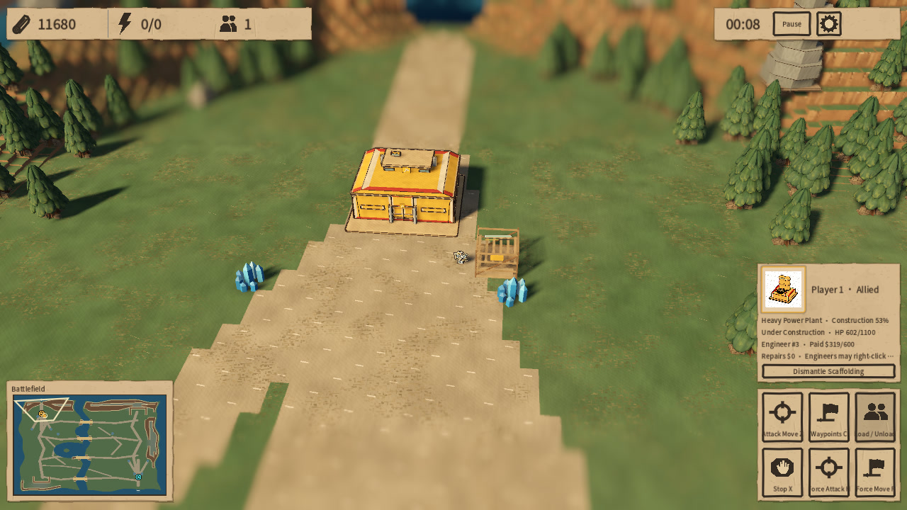

# Paper Front · 纸境战线

**Build a paper army. Fight for the final draft.**

A desktop real-time strategy game set on a handcrafted tabletop: painted cardboard bases, cut-paper infantry, armored columns, aircraft and fleets. Four rival armies turn their creators’ competing blueprints into an industrial war.

[Download v0.8.0 preview](https://github.com/flitting/PaperFront/releases/tag/v0.8.0) · [Watch the trailer](media/paper-front-trailer.mp4) · [Documentation](docs/README.md) · [简体中文](#简体中文)



## What you can play

- Single-player skirmishes against up to three AI opponents, with four playable factions and independent player colors.
- Six 320 × 320 battlefields: forest, desert, snow, river-port city, seeded city and islands; plus a 192 × 192 symmetric map for two armies.
- A playable Canon Legion tutorial mission that teaches economy, engineering and combat.
- Base construction, crystal mining, local power, technology, infantry squads, armored warfare, air service, naval combat, transports and building garrisons.
- Destructible bridges and obstacles, engineer repairs and capture, armor penetration, friendly-fire splash and veteran units.
- An in-game Wiki with real model previews, unit statistics and an audio browser; match history charts and JSON/CSV reports.
- English and Simplified Chinese interface and voice options, selected independently. Both default to English. Gameplay and packaged audio run offline.

This is an evolving desktop game. There is no online multiplayer, mobile/web build or macOS release. Balance and large-battle performance continue to develop; historical benchmark and AI results are not promises for every map or machine.

## Download and run

Download the archive for your system from [GitHub Releases](https://github.com/flitting/PaperFront/releases/tag/v0.8.0), extract the **entire folder**, then launch:

| Platform | Release archive | Launch |
|---|---|---|
| Linux x86_64 | `PaperFront-v0.8.0-linux-x86_64.tar.gz` | `./start.sh` |
| Windows x86_64 | `PaperFront-v0.8.0-windows-x86_64.zip` | Double-click `PaperFront.exe` |

The packages include the Godot runtime and the matching native library. Players do not need to install Godot, Python or a compiler. Keep all extracted files together. On Windows, use the root launcher so saves and caches stay in the portable folder.

```sh
# Linux, from the extracted release folder
chmod +x start.sh PaperFront.x86_64
./start.sh
```

**Runtime requirements:** a 64-bit desktop OS, keyboard and mouse, and a Vulkan-capable graphics card with a current driver. The minimum window is 1100 × 700; 1600 × 900 or larger gives the HUD more space. Windows targets Windows 10/11 x64. Linux requires glibc 2.38 or newer. See the [v0.8.0 release notes](docs/release_notes.md) and [validation record](docs/release_validation.md) for checks and outstanding limits; a Windows cross-build or Wine check does not establish Windows hardware validation.

If rendering is slow, lower quality or 3D render scale in Settings. UI resolution stays unchanged. If the game does not open, check the log and graphics driver, and include the release version and platform in an [issue](https://github.com/flitting/PaperFront/issues).

## Meet the factions

| Faction | Approach |
|---|---|
| **Canon Legion · 正典军团** | Elite infantry and affordable armor; establish the basic industry quickly, then invest in expensive advanced technology. |
| **Heavy Hammer Legion · 重锤军团** | Armed engineers construct buildings on site. Repeatable Base Barracks support expansion while mining drills, heavy tanks and bombing airships hold the line. |
| **Long Nail Legion · 长钉军团** | Railway logistics, armored trains and durable vehicles. Its harvesters and trains need friendly track; eligible vehicles repair themselves after leaving combat. |
| **Skywing Order · 天翼教团** | Fragile, expensive high technology: EMP disruption, lasers, sustained beams, strong aviation and the unique Creator Hand. |

Exact costs, prerequisites and abilities are shown in production cards and the Wiki. See the generated [faction reference](docs/faction_catalog.md) for the current rule data.

## Your first match

1. Start with the **tutorial**, or choose **Skirmish**, a faction, a battlefield and AI opponents. The symmetric map is a clear place to learn a two-army land battle.
2. For Canon, Long Nail and Skywing, select the Headquarters, order a power plant, then establish a refinery and barracks. A completed building order must be placed on valid ground. Long Nail needs railway connections for its mining vehicles.
3. For Heavy Hammer, select the Base Barracks and train an engineer. Select that engineer to place construction sites, including mining drills at crystal deposits. Work is paid for as construction progresses; extra Base Barracks extend the base.
4. Keep production facilities supplied with power and their doors clear. Barracks unlock the next technology stage; factories or airfields open further development, followed by the faction’s technology building.
5. Recruit infantry squads and supporting vehicles. Drag-select troops, right-click to move or attack, and use **Z then left-click** for attack-move.
6. Destroy all enemy buildings that count toward survival. Walls, barricades and railway infrastructure do not keep an otherwise defeated army alive.

Most combat infantry are recruited as squads of 2–6 soldiers; engineers remain individuals. Each soldier has separate health, experience and a transport seat. Orders select and control the squad together. Production prices and times represent the whole squad, and casualties do not replenish for free.



## Controls

Commands followed by a click enter a targeting mode; **Esc** cancels it. Controls are shared by both interface languages.

| Input | Action |
|---|---|
| Left-click / drag | Select a unit or squad / box-select |
| Shift + selection or command | Add/remove selection or queue a command |
| Right-click ground / enemy | Move / attack target; contextual engineering, boarding and garrison actions |
| Z, then left-click | Attack-move |
| X | Stop and clear orders |
| C, then left-click points | Queue waypoints |
| G, then left-click | Patrol between current position and destination |
| H, then left-click | Force attack a target or ground; can damage friendly and neutral objects |
| F, then left-click | Force move; eligible vehicles can crush enemy infantry |
| Ctrl + 1–6 / 1–6 | Save / select a control group |
| Right-click with a production building selected | Set its rally point |
| B | Return selected aircraft to an airfield; send a harvester back to unload |
| L, then left-click | Land a transport aircraft on valid ground |
| U, then left-click | Move a transport to unload; **U** also evacuates an inspected friendly garrison |
| R while placing / V while placing rails | Rotate building / change rail orientation |
| WASD / middle-mouse drag / screen edges | Pan camera |
| Q / E | Orbit camera |
| Mouse wheel | Zoom; over cards, scroll the cards |
| R / T outside placement | Adjust camera pitch |
| Space / Home | Jump to the latest combat hotspot / home base |
| P / Pause | Pause or resume a skirmish |
| F5 / F9 | Save / load the skirmish |
| Esc / gear button | Cancel the current action or open Settings |

Production cards and the selection panel also expose building repair/sale, loading/unloading and other contextual commands. [Game design](docs/design.md) explains construction, power, combat and save behavior in more detail.

## Saves, settings and reports

| Data | Location |
|---|---|
| Linux player data | `~/.local/share/godot/app_userdata/纸境战线 · Paper Front/` (or the corresponding `XDG_DATA_HOME`) |
| Windows portable player data | `user_data/` beside `PaperFront.exe` |
| Skirmish save | `skirmish_v1.pfront` inside the player data folder |
| Preferences | `settings.cfg` inside the player data folder |
| Match JSON/CSV exports | `match_reports/` inside the player data folder |

Saves contain the actual map, simulation state and a rules snapshot. An older save can keep older unit costs and mechanics; start a **new match** to use the current rules. Move the entire Windows portable folder to carry its saves with it. See [Windows portable details](docs/windows_portable.md) for logs, caches and reset instructions.

## Run from source

Use **Godot 4.6.2 stable**, the standard edition; C#/.NET is not required. The project uses GDScript and a project-authored C++ GDExtension with the Forward+ renderer.

```sh
git clone https://github.com/flitting/PaperFront.git
cd PaperFront
./run.sh
```

`run.sh` always launches the current source tree and imports changed resources when needed. To use a specific Godot binary:

```sh
PAPER_FRONT_GODOT=/path/to/godot ./run.sh
```

On Windows, open `project.godot` in Godot 4.6.2 and press **F5**, or run `godot --path .` after importing the project. Build the matching native library when your platform needs it; Linux’s checked-in `.so` is not a Windows library.

To rebuild the native module, install **CMake, Make, a C++17 compiler and Python 3**, then run:

```sh
./tools/build_native.sh
```

Windows cross-builds on Linux also need the **MinGW-w64 POSIX x86_64 toolchain**, ImageMagick and Pillow for the launcher icon. Godot’s matching **4.6.2 export templates** are required for packaged builds. See [native build instructions](native/README.md).

## Build and check a release

```sh
# Linux and Windows x86_64 packages, including native libraries and notices
python3 tools/build_release.py --version 0.8.0 --output artifacts/release_20261011

# Full project regression runner; requires the native library
PAPER_FRONT_GODOT=godot ./tools/test.sh
```

`PAPER_FRONT_GODOT` selects Godot; `PAPER_FRONT_MINGW_BIN` can select an unpacked MinGW toolchain. Build outputs and diagnostic evidence go under the ignored `artifacts/` directory. The full runner checks engine/script errors and resource leaks as well as process exit status. See the release notes for what was actually run and any outstanding failures; the command alone is not a claim that every historical test passes.

For simulation-only experiments:

```sh
./tools/run_headless.sh --map symmetric --factions kestrel,sky --ai both \
  --ai-styles balanced --difficulty normal --duration 120 --output /tmp/paper-front-match
./tools/build_headless.sh
```

See [headless runs and statistics](docs/balance_preparation.md), [AI balance experiments](docs/ai_balance_experiments.md) and [independent strategy modules](docs/independent_ai_duel.md).

## Project map

| Path | Purpose |
|---|---|
| `data/rules.json` | Economy, factions, units, buildings, weapons and prerequisites |
| `data/localization/` | English translation catalogs; Chinese source identifiers remain stable |
| `scripts/simulation.gd` and simulation modules | Authoritative rules and save state |
| `scripts/main.gd`, `paper_hud.gd`, `paper_world.gd` | Input/camera, interface and read-only scene presentation |
| `native/` | C++ kernels, pinned Godot C++ bindings and build configuration |
| `assets/` | Artwork, audio, shaders, fonts and asset provenance |
| `tests/`, `tools/` | Regression checks, asset tooling, headless experiments and packaging |
| `docs/` | Current guides, reference material and selected experiment evidence |
| `media/` | Trailer, poster and promotional screenshots |

The [architecture guide](docs/architecture.md) describes the simulation/rendering boundary and developer workflow. Bug reports should include steps to reproduce, the map/seed, faction, version, platform and relevant logs. For rule or visual changes, include focused tests or before/after captures where they help reviewers verify the result.

## Credits and licensing

Read [asset licenses and provenance](assets/LICENSE.md) and the `LICENSES/` and `PROVENANCE/` folders included in each release. Godot and godot-cpp use MIT, Noto CJK uses SIL OFL, and the Creator Hand is derived from MakeHuman CC0 graphical assets. Project-authored assets identified as CC0, synthetic speech, and provider-generated audio have separate documented scopes. Chinese and English voices are synthetic, not human recordings.

**The repository currently has no single license granting reuse of all game source code.** Asset and dependency licenses do not automatically license the rest of the project. User-supplied style references remain documentation references and are excluded from player packages.

---

## 简体中文

**组建纸上军团，争夺最终定稿。**

《纸境战线》是一款发生在手工桌面模型世界中的即时战略游戏。纸板基地、剪纸步兵、装甲车队、飞机与舰队，在四套相互竞争的“正确图纸”之间展开工业战争。

[下载 v0.8.0 试玩版](https://github.com/flitting/PaperFront/releases/tag/v0.8.0) · [观看宣传视频](media/paper-front-trailer.mp4) · [文档索引](docs/README.md)

### 游戏内容

- 单人对抗最多三名电脑，四个可玩阵营，玩家颜色与阵营身份独立。
- 六张 320 × 320 战场：森林、沙漠、雪原、河港城市、种子城市与群岛；另有 192 × 192 的两军对称地图。
- 一关正典军团教程，涵盖经济、工程与战斗。
- 基地建设、晶矿经济、局部供电、科技、小队步兵、装甲、航空与海军、运输和驻军。
- 可破坏桥梁与障碍、工兵维修和占领、护甲穿透、溅射友伤及星级单位。
- 游戏内图鉴、真实模型预览、音频浏览器，以及结算曲线和 JSON/CSV 对局报告。
- 界面与语音均支持 English / 简体中文，可以分别选择并保存；两项默认英语。游戏和发行包音频可离线运行。

当前提供桌面单人版本；暂无真人联网、手机、网页或 macOS 发行包。数值平衡和大规模战斗性能仍在完善。

### 下载与启动

从 [GitHub Releases](https://github.com/flitting/PaperFront/releases/tag/v0.8.0) 下载并完整解压：

| 系统 | 文件 | 启动方式 |
|---|---|---|
| Linux x86_64 | `PaperFront-v0.8.0-linux-x86_64.tar.gz` | 在解压目录运行 `./start.sh` |
| Windows x86_64 | `PaperFront-v0.8.0-windows-x86_64.zip` | 双击根目录 `PaperFront.exe` |

玩家无需安装 Godot 或编译器。请保留整个目录，不要只移动主程序。Windows 须通过根目录启动器运行，以将数据保存在便携目录中。

需要 64 位系统、键鼠与支持 Vulkan 的显卡和驱动；最低窗口 1100 × 700，建议使用更大的显示空间。Windows 面向 Windows 10/11 x64；Linux 需要 glibc 2.38 或更新版本。具体构建、检查范围及已知限制见 [v0.8.0 发布说明](docs/release_notes.md)与[验证记录](docs/release_validation.md)，Windows 交叉编译或 Wine 检查不代表 Windows 实机验收。性能不足时可在设置中降低画质或 3D 渲染倍率，界面仍使用原始分辨率。

### 四个阵营

| 阵营 | 特点 |
|---|---|
| 正典军团 · Canon Legion | 精锐步兵搭配廉价装甲，基础工业成型快，高级科技投入昂贵。 |
| 重锤军团 · Heavy Hammer Legion | 武装工兵现场搭建全部建筑，基地兵营可反复建造；以矿脉钻机、重坦与轰炸飞艇支撑扩张。 |
| 长钉军团 · Long Nail Legion | 铁路运输、装甲列车与耐用车辆；矿车及列车依赖己方轨道，符合条件的车辆可脱战自修复。 |
| 天翼教团 · Skywing Order | 昂贵而脆弱的高科技：EMP、激光、束流、强力航空与独特的创世之手。 |

价格、前置和能力以生产卡、图鉴及[当前规则目录](docs/faction_catalog.md)为准。

### 如何开始

1. 先玩教程，或在遭遇战中选择阵营、地图和电脑。初学陆战可选择两方的明原对称场。
2. 正典、长钉和天翼先选总部，建设电站、精炼厂和兵营；建筑订单完成后还需放到合法位置。长钉矿车需要己方铁路连通。
3. 重锤先从基地兵营训练工程兵，再选工兵放置施工现场与矿点钻机，随施工进度付款；新基地兵营用于扩张。
4. 保持供电和生产出口通畅，逐步解锁工厂、机场和科技设施。
5. 训练步兵小队与支援载具，拖框选择、右键行军或攻击，**Z 后左键**指定攻击移动。
6. 摧毁敌方所有计入生存的建筑获胜；围墙、拒马与铁路不能单独维持阵营存活。

普通战斗步兵按 2–6 人小队购买，工兵仍为单人。每名成员独立计算生命、经验、碰撞和运输座位；命令以小队为单位下达，价格与时间是整队总额，伤亡不会免费补充。

### 常用操作

| 输入 | 功能 |
|---|---|
| 左键 / 拖框；Shift | 选择 / 多选；增减选择或追加命令 |
| 右键 | 移动、攻击，以及维修、占领、登乘和驻军等情境操作 |
| Z / X / C / G | 攻击移动 / 停止 / 路径点 / 巡逻；需要目标的命令随后左键指定 |
| H / F 后左键 | 强制攻击 / 强制移动；强制攻击可伤及友方与中立物 |
| Ctrl + 1–6 / 1–6 | 保存 / 选择编队 |
| 生产设施选中时右键 | 设置集结点 |
| B | 飞机返航；矿车回厂卸矿 |
| L / U 后左键 | 运输机降落 / 运输载具前往卸载；查看己方驻军房屋时 U 撤出 |
| 放置建筑时 R / 放置铁路时 V | 旋转建筑 / 切换铁路朝向 |
| WASD / 中键拖动 / 屏幕边缘 | 平移镜头 |
| Q / E；滚轮；非放置时 R / T | 环绕；缩放；调整俯角 |
| 空格 / Home | 跳到最近交战热点 / 回基地 |
| P / Pause；F5 / F9 | 暂停；保存 / 读取 |
| Esc / 齿轮 | 取消当前操作或打开设置 |

### 存档、开发与反馈

Linux 数据默认保存在 `~/.local/share/godot/app_userdata/纸境战线 · Paper Front/`；Windows 便携包保存在启动器旁的 `user_data/`。存档为 `skirmish_v1.pfront`，偏好为 `settings.cfg`，结算报告位于 `match_reports/`。旧存档带自己的规则快照，查看最新机制请新开对局。

源码需要 **Godot 4.6.2 stable 标准版**，克隆后运行 `./run.sh`；可用 `PAPER_FRONT_GODOT` 指定引擎。原生内核需要 CMake、Make、C++17 编译器和 Python 3，通过 `./tools/build_native.sh` 重建。Windows 交叉编译另需 MinGW-w64 POSIX 工具链及启动器图标依赖。两平台打包使用：

```sh
python3 tools/build_release.py --version 0.8.0 --output artifacts/release_20261011
PAPER_FRONT_GODOT=godot ./tools/test.sh
```

构建和检查细节见[工程接口](docs/architecture.md)、[原生模块](native/README.md)与[发布说明](docs/release_notes.md)。反馈问题请在 [Issues](https://github.com/flitting/PaperFront/issues) 附复现步骤、版本、系统、阵营、地图/种子和日志。

项目没有覆盖全部源码的统一许可；请分别查看[素材与依赖许可](assets/LICENSE.md)及发行包内的 `LICENSES/`、`PROVENANCE/`。原创 CC0 美术、合成语音和供应商生成音频的授权范围分别记录；中英文语音均为合成声音。用户提供的风格参考仅用于文档，不进入玩家包。

宣传视频及截图来自游戏引擎内渲染的编排展示场景。 / Trailer and screenshots use staged in-engine showcase scenes.
