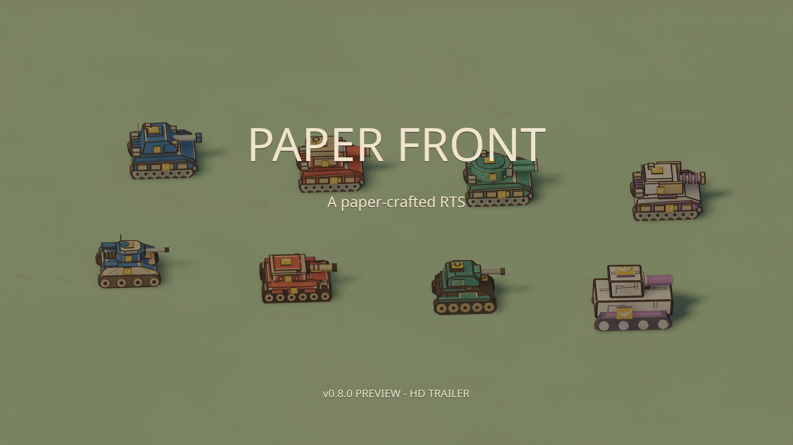

# Paper Front

**Build a paper army. Fight for the final draft.**

A desktop real-time strategy game set on a handcrafted tabletop: painted cardboard bases, cut-paper infantry, armored columns, aircraft and fleets. Four rival armies turn their creators’ competing blueprints into an industrial war.

[Download v0.8.0 preview](https://github.com/flitting/PaperFront/releases/tag/v0.8.0) · [Watch the HD trailer](https://github.com/flitting/PaperFront/releases/download/v0.8.0/paper-front-trailer.mp4) · [Documentation](docs/README.md) · [Simplified Chinese](README.zh-CN.md)

[](https://github.com/flitting/PaperFront/releases/download/v0.8.0/paper-front-trailer.mp4)

The 29-second trailer combines native 4K in-engine model renders with a controlled battle sequence, delivered at **1920×1080**. The model scenes are staged showcases; the battle uses ordinary commands and simulation.

## What you can play

- Single-player skirmishes against up to three AI opponents, with four playable factions and independent player colors.
- Six 320 × 320 battlefields: forest, desert, snow, river-port city, seeded city and islands; plus a 192 × 192 symmetric map for two armies.
- A playable Canon Legion tutorial mission that teaches economy, engineering and combat.
- Base construction, crystal mining, local power, technology, infantry squads, armored warfare, air service, naval combat, transports and building garrisons.
- Destructible bridges and obstacles, engineer repairs and capture, armor penetration, friendly-fire splash and veteran units.
- An in-game Wiki with real model previews, unit statistics and an audio browser; match history charts and JSON/CSV reports.
- English and Simplified Chinese interface and voice options, selected independently. Both default to English. Gameplay and packaged audio run offline.

This is an evolving desktop game. There is no online multiplayer, mobile/web build or macOS release. Balance and large-battle performance continue to develop; historical benchmark and AI results are not promises for every map or machine.

## Download and run

Download the archive for your system from [GitHub Releases](https://github.com/flitting/PaperFront/releases/tag/v0.8.0), extract the **entire folder**, then launch:

| Platform | Release archive | Launch |
|---|---|---|
| Linux x86_64 | `PaperFront-v0.8.0-linux-x86_64.tar.gz` | `./start.sh` |
| Windows x86_64 | `PaperFront-v0.8.0-windows-x86_64.zip` | Double-click `PaperFront.exe` |

The packages include the Godot runtime and the matching native library. Players do not need to install Godot, Python or a compiler. Keep all extracted files together. On Windows, use the root launcher so saves and caches stay in the portable folder.

```sh
# Linux, from the extracted release folder
chmod +x start.sh PaperFront.x86_64
./start.sh
```

**Runtime requirements:** a 64-bit desktop OS, keyboard and mouse, and a Vulkan-capable graphics card with a current driver. The minimum window is 1100 × 700; 1600 × 900 or larger gives the HUD more space. Windows targets Windows 10/11 x64. Linux requires glibc 2.38 or newer. See the [v0.8.0 release notes](docs/release_notes.md) and [validation record](docs/release_validation.md) for checks and outstanding limits; a Windows cross-build or Wine check does not establish Windows hardware validation.

If rendering is slow, lower quality or 3D render scale in Settings. UI resolution stays unchanged. If the game does not open, check the log and graphics driver, and include the release version and platform in an [issue](https://github.com/flitting/PaperFront/issues).

## Meet the factions

| Faction | Approach |
|---|---|
| **Canon Legion** | Elite infantry and affordable armor; establish the basic industry quickly, then invest in expensive advanced technology. |
| **Heavy Hammer Legion** | Armed engineers construct buildings on site. Repeatable Base Barracks support expansion while mining drills, heavy tanks and bombing airships hold the line. |
| **Long Nail Legion** | Railway logistics, armored trains and durable vehicles. Its harvesters and trains need friendly track; eligible vehicles repair themselves after leaving combat. |
| **Skywing Order** | Fragile, expensive high technology: EMP disruption, lasers, sustained beams, strong aviation and the unique Creator Hand. |

Exact costs, prerequisites and abilities are shown in production cards and the Wiki. See the generated [faction reference](docs/faction_catalog.md) for the current rule data.

## Your first match

1. Start with the **tutorial**, or choose **Skirmish**, a faction, a battlefield and AI opponents. The symmetric map is a clear place to learn a two-army land battle.
2. For Canon, Long Nail and Skywing, select the Headquarters, order a power plant, then establish a refinery and barracks. A completed building order must be placed on valid ground. Long Nail needs railway connections for its mining vehicles.
3. For Heavy Hammer, select the Base Barracks and train an engineer. Select that engineer to place construction sites, including mining drills at crystal deposits. Work is paid for as construction progresses; extra Base Barracks extend the base.
4. Keep production facilities supplied with power and their doors clear. Barracks unlock the next technology stage; factories or airfields open further development, followed by the faction’s technology building.
5. Recruit infantry squads and supporting vehicles. Drag-select troops, right-click to move or attack, and use **Z then left-click** for attack-move.
6. Destroy all enemy buildings that count toward survival. Walls, barricades and railway infrastructure do not keep an otherwise defeated army alive.

Most combat infantry are recruited as squads of 2–6 soldiers; engineers remain individuals. Each soldier has separate health, experience and a transport seat. Orders select and control the squad together. Production prices and times represent the whole squad, and casualties do not replenish for free.


## Controls

Commands followed by a click enter a targeting mode; **Esc** cancels it. Controls are shared by both interface languages.

| Input | Action |
|---|---|
| Left-click / drag | Select a unit or squad / box-select |
| Shift + selection or command | Add/remove selection or queue a command |
| Right-click ground / enemy | Move / attack target; contextual engineering, boarding and garrison actions |
| Z, then left-click | Attack-move |
| X | Stop and clear orders |
| C, then left-click points | Queue waypoints |
| G, then left-click | Patrol between current position and destination |
| H, then left-click | Force attack a target or ground; can damage friendly and neutral objects |
| F, then left-click | Force move; eligible vehicles can crush enemy infantry |
| Ctrl + 1–6 / 1–6 | Save / select a control group |
| Right-click with a production building selected | Set its rally point |
| B | Return selected aircraft to an airfield; send a harvester back to unload |
| L, then left-click | Land a transport aircraft on valid ground |
| U, then left-click | Move a transport to unload; **U** also evacuates an inspected friendly garrison |
| R while placing / V while placing rails | Rotate building / change rail orientation |
| WASD / middle-mouse drag / screen edges | Pan camera |
| Q / E | Orbit camera |
| Mouse wheel | Zoom; over cards, scroll the cards |
| R / T outside placement | Adjust camera pitch |
| Space / Home | Jump to the latest combat hotspot / home base |
| P / Pause | Pause or resume a skirmish |
| F5 / F9 | Save / load the skirmish |
| Esc / gear button | Cancel the current action or open Settings |

Production cards and the selection panel also expose building repair/sale, loading/unloading and other contextual commands. [Game design](docs/design.md) explains construction, power, combat and save behavior in more detail.

## Saves, settings and reports

| Data | Location |
|---|---|
| Linux player data | `~/.local/share/godot/app_userdata/<application-name>/` (or the corresponding `XDG_DATA_HOME`) |
| Windows portable player data | `user_data/` beside `PaperFront.exe` |
| Skirmish save | `skirmish_v1.pfront` inside the player data folder |
| Preferences | `settings.cfg` inside the player data folder |
| Match JSON/CSV exports | `match_reports/` inside the player data folder |

`<application-name>` is a placeholder for the exact `application/config/name` value in [project.godot](project.godot), including its spaces and punctuation. It is not the repository folder name. When set, `XDG_DATA_HOME` replaces `~/.local/share`.

Saves contain the actual map, simulation state and a rules snapshot. An older save can keep older unit costs and mechanics; start a **new match** to use the current rules. Move the entire Windows portable folder to carry its saves with it. See [Windows portable details](docs/windows_portable.md) for logs, caches and reset instructions.

## Run from source

Use **Godot 4.6.2 stable**, the standard edition; C#/.NET is not required. The project uses GDScript and a project-authored C++ GDExtension with the Forward+ renderer.

```sh
git clone https://github.com/flitting/PaperFront.git
cd PaperFront
./run.sh
```

`run.sh` always launches the current source tree and imports changed resources when needed. To use a specific Godot binary:

```sh
PAPER_FRONT_GODOT=/path/to/godot ./run.sh
```

On Windows, open `project.godot` in Godot 4.6.2 and press **F5**, or run `godot --path .` after importing the project. Build the matching native library when your platform needs it; Linux’s checked-in `.so` is not a Windows library.

To rebuild the native module, install **CMake, Make, a C++17 compiler and Python 3**, then run:

```sh
./tools/build_native.sh
```

Windows cross-builds on Linux also need the **MinGW-w64 POSIX x86_64 toolchain**, ImageMagick and Pillow for the launcher icon. Godot’s matching **4.6.2 export templates** are required for packaged builds. See [native build instructions](native/README.md).

## Build and check a release

```sh
# Linux and Windows x86_64 packages, including native libraries and notices
python3 tools/build_release.py --version 0.8.0 --output artifacts/release_20261011

# Full project regression runner; requires the native library
PAPER_FRONT_GODOT=godot ./tools/test.sh
```

`PAPER_FRONT_GODOT` selects Godot; `PAPER_FRONT_MINGW_BIN` can select an unpacked MinGW toolchain. Build outputs and diagnostic evidence go under the ignored `artifacts/` directory. The full runner checks engine/script errors and resource leaks as well as process exit status. See the release notes for what was actually run and any outstanding failures; the command alone is not a claim that every historical test passes.

For simulation-only experiments:

```sh
./tools/run_headless.sh --map symmetric --factions kestrel,sky --ai both \
  --ai-styles balanced --difficulty normal --duration 120 --output /tmp/paper-front-match
./tools/build_headless.sh
```

See [headless runs and statistics](docs/balance_preparation.md), [AI balance experiments](docs/ai_balance_experiments.md) and [independent strategy modules](docs/independent_ai_duel.md).

## Project map

| Path | Purpose |
|---|---|
| `data/rules.json` | Economy, factions, units, buildings, weapons and prerequisites |
| `data/localization/` | English translation catalogs; Chinese source identifiers remain stable |
| `scripts/simulation.gd` and simulation modules | Authoritative rules and save state |
| `scripts/main.gd`, `paper_hud.gd`, `paper_world.gd` | Input/camera, interface and read-only scene presentation |
| `native/` | C++ kernels, pinned Godot C++ bindings and build configuration |
| `assets/` | Artwork, audio, shaders, fonts and asset provenance |
| `tests/`, `tools/` | Regression checks, asset tooling, headless experiments and packaging |
| `docs/` | Current guides, reference material and selected experiment evidence |
| `media/` | Trailer, poster and promotional screenshots |

The [architecture guide](docs/architecture.md) describes the simulation/rendering boundary and developer workflow. Bug reports should include steps to reproduce, the map/seed, faction, version, platform and relevant logs. For rule or visual changes, include focused tests or before/after captures where they help reviewers verify the result.

## Credits and licensing

Read [asset licenses and provenance](assets/LICENSE.md) and the `LICENSES/` and `PROVENANCE/` folders included in each release. Godot and godot-cpp use MIT, Noto CJK uses SIL OFL, and the Creator Hand is derived from MakeHuman CC0 graphical assets. Project-authored assets identified as CC0, synthetic speech, and provider-generated audio have separate documented scopes. Chinese and English voices are synthetic, not human recordings.

**The repository currently has no single license granting reuse of all game source code.** Asset and dependency licenses do not automatically license the rest of the project. User-supplied style references remain documentation references and are excluded from player packages.
