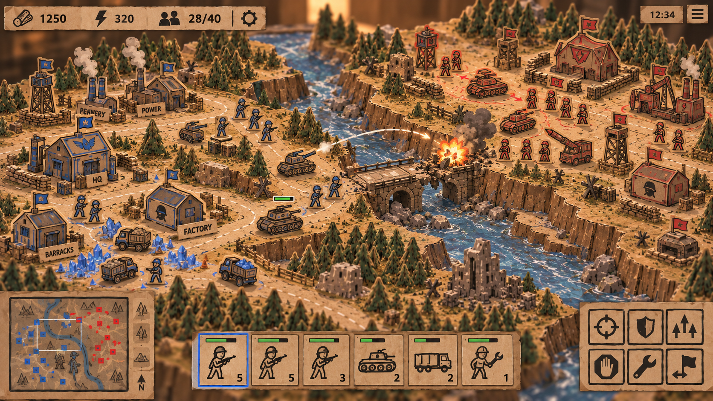
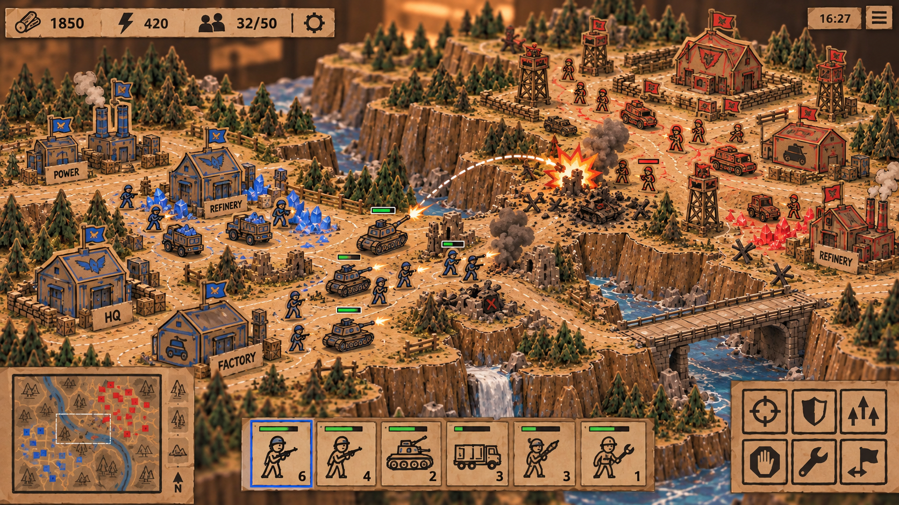

# Visual references and capture workflow / 美术参考与截图流程

The art direction is a **hand-painted tabletop diorama**: cardboard terrain, thick buildings and vehicles, cut-paper infantry, visible pigment, dark ink edges and useful play space. Judge changes at the normal RTS camera distance before relying on close-ups.

美术目标是具有真实体积的手绘桌面模型。正常 RTS 镜头下应先看清部队、建筑、通路和所属色；资产特写用于诊断，压力场用于性能测量，不代替普通游玩视角。

## Reference ownership / 参考来源

The two style references below were supplied by the user. They are documentation references, not game textures or project-authored CC0 assets, and are excluded from player packages. UI text, unit counts and layout in a reference image do not define game rules.





Additional terrain/pine references remain under [references/](references/). The map concept briefs, prompts and checksum records are under [map_design_v6/](map_design_v6/requirements.md). Creator Hand reference poses remain under [revision_v6/](revision_v6/); graphical mesh attribution is recorded in [the asset notes](../assets/creator_hand/README.md).

## What to inspect / 检查重点

| Area | Target |
|---|---|
| Silhouette | Buildings read as solid structures; vehicles show hull, tracks/wheels and turret; infantry remain clear cut-paper figures |
| Palette | Warm paper ground, cool water/forest shadows, visible faction identity and distinct player colors |
| Material | Matte painted paper, irregular brush/ink accents and useful thickness rather than a shiny plastic finish |
| Terrain | Readable height, ramps, riverbanks and bridges; visual routes agree with movement rules |
| Framing | Bases, routes and battle space connect; close scenery does not block selection or hide units |
| Effects | Clear firing, impact and damage feedback with limited obstruction from smoke and debris |
| UI | Native-resolution readable HUD, accurate prices/portrait/selection markers and no unwanted camera scroll over cards |

## Reproducible capture / 可重复采集

`tools/capture_golden.py` can start the actual game, load a saved visual fixture, render the gameplay and G0 views, then save PNGs, metadata and logs:

```sh
python3 tools/capture_golden.py --name review --views gameplay,g0 \
  --output-dir artifacts/visual_review/review \
  --fixture data/golden_visual_paintedforest_v9.json
```

Use a new output directory for each comparison. A baseline can be supplied with `--baseline <previous-capture-directory>`. The G0 fixture is a staged diagnostic state, not a normal player opening. Record camera, resolution, renderer, fixture and source identity; compare the resulting images visually. A successful capture or matching metadata alone does not prove better art.

For a model change, check animation, muzzle locations, selection and collision agreement. For terrain changes, verify traversable routes and bridge state. For HUD changes, check the 1100 × 700 minimum window and both languages. Run GPU benchmarks one at a time without concurrent compilation or CPU-heavy tests.

截图是实际游戏渲染结果；固定布局或编排展示必须注明，不称为自然游玩录像。对比应保留前后图、元数据和运行条件，不能只凭代码或截图命令成功宣称视觉改善。
